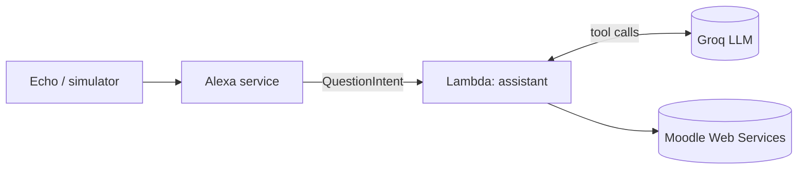

# Alexa AI Assistant

[](https://github.com/gera2727/alexa-ai-assistant/actions/workflows/ci.yml)


**English** · [Português](README.pt.md)

A personal voice assistant for Amazon Alexa, written in Python. Ask it anything about
your university's Moodle in your own words: an LLM decides which data to fetch (calendar,
courses, materials, assignments) through tool calling and answers in one short sentence.
It runs entirely on free tiers.

> **User:** "Alexa, abre o meu painel."
>
> **Alexa:** "Olá! Pergunta-me o que quiseres sobre as tuas aulas, testes, entregas ou materiais do Moodle."
>
> **User:** "Quando é o teste de ESINF?"
>
> **Alexa:** "O teste de ESINF é na sexta-feira, dia 6, às 10:00."

## Features

| Capability | Example utterance (pt) | Status |
|---|---|---|
| Calendar: tests, exams, deadlines | "o que tenho amanhã", "quando é o teste de ESINF" | ✅ |
| Assignment deadlines, per course | "que entregas tenho de LAPR3" | ✅ |
| Course materials | "que materiais há em ARQCP" | ✅ |
| Enrolled courses | "quais são as minhas disciplinas" | ✅ |
| Timetable and rooms | "onde é que tenho aula hoje" | 📋 Backlog |

## Architecture



One catch-all intent sends the whole question to an agent loop. The LLM calls read-only
tools, the tools call Moodle, and every layer receives its dependencies by injection, so
each one is tested without network. The design is explained in
[ADR 0004](docs/adr/0004-free-form-questions.md). Details in [docs/architecture.md](docs/architecture.md).

## Project structure

```
.
├── lambda/                      # Deployed to AWS Lambda (layout required by Alexa-hosted skills)
│   ├── lambda_function.py       # Entry point
│   ├── requirements.txt         # Runtime dependencies
│   ├── config.example.json      # Template for the git-ignored config.json
│   └── assistant/
│       ├── skill.py             # Composition root: wires handlers and dependencies
│       ├── config.py            # Settings from env vars or config.json
│       ├── agent.py             # LLM tool-calling loop and system prompt
│       ├── tools.py             # Read-only tools the LLM can call
│       ├── handlers/            # Alexa handlers (question, builtin, errors)
│       └── integrations/        # moodle_api, llm (no Alexa imports)
├── scripts/                     # Setup helpers: get a Moodle token, check API access
├── skill-package/               # Alexa skill manifest and interaction model
├── tests/
│   ├── unit/                    # Pure functions, no SDK
│   └── integration/             # Full request envelope → spoken response
└── docs/
    ├── architecture.md
    ├── setup.md
    └── adr/                     # Architecture Decision Records
```

## Getting started

```bash
git clone https://github.com/gera2727/alexa-ai-assistant.git
cd alexa-ai-assistant
python3 -m venv .venv && source .venv/bin/activate
pip install -r requirements-dev.txt
pytest
```

To deploy to a real Alexa skill, follow [docs/setup.md](docs/setup.md).

## Engineering practices

- **Tests:** every integration is tested with a fake transport (no network), the agent loop
  with a scripted LLM, and end-to-end tests send real Alexa request envelopes through the skill.
- **CI:** GitHub Actions runs `ruff` (lint and format) and `pytest` on Python 3.10 and 3.12.
- **Decisions** are recorded as [ADRs](docs/adr/README.md): hosting, locale, LLM provider and the free-form design.
- **Process:** a solo Scrum with weekly sprints, tracked on the [GitHub Project board](https://github.com/gera2727/alexa-ai-assistant/projects).
- **Security:** the Moodle token and Groq key are read from the environment or a
  git-ignored file, sent in request bodies (never URLs) and never logged. Tools are read-only.

## Roadmap

See the [project board](https://github.com/gera2727/alexa-ai-assistant/projects) and [CHANGELOG.md](CHANGELOG.md).

## License

[MIT](LICENSE)
