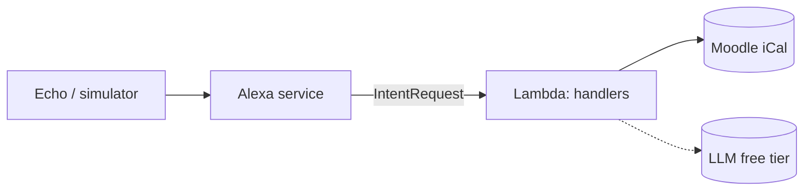

# Alexa AI Assistant

[](https://github.com/gera2727/alexa-ai-assistant/actions/workflows/ci.yml)


**English** · [Português](README.pt.md)

A personal voice assistant for Amazon Alexa, written in Python. It reads university
deadlines from Moodle and, in the next phase, answers open questions with an LLM.
It runs entirely on free tiers.

> **User:** "Alexa, pergunta à agenda do isep o que tenho esta semana."
>
> **Alexa:** "Nos próximos 7 dias tens 2 eventos: Entrega Sprint 1, de LAPR3, amanhã às 23:59; e Teste de ESINF, de ESINF, sexta-feira às 10:00."

## Features

| Capability | Example utterance (pt) | Status |
|---|---|---|
| Upcoming deadlines (next 7 days) | "o que tenho esta semana" | ✅ |
| Events on a day or week | "o que tenho amanhã", "para a semana" | ✅ |
| Next deadline | "qual é a próxima entrega" | ✅ |
| Open questions with an LLM | "explica-me recursividade" | 🔜 [Sprint 2](https://github.com/gera2727/alexa-ai-assistant/milestone/2) |
| Filter by course | "o que tenho de ESINF" | 📋 Backlog |

## Architecture



Handlers are thin and receive their dependencies by injection. Integrations never
import the Alexa SDK, so they are tested on their own. Details in
[docs/architecture.md](docs/architecture.md).

## Project structure

```
.
├── lambda/                      # Deployed to AWS Lambda (layout required by Alexa-hosted skills)
│   ├── lambda_function.py       # Entry point
│   ├── requirements.txt         # Runtime dependencies
│   ├── config.example.json      # Template for the git-ignored config.json
│   └── assistant/
│       ├── skill.py             # Composition root: wires handlers and dependencies
│       ├── config.py            # Settings from env vars or config.json
│       ├── dates.py             # AMAZON.DATE slot parsing
│       ├── speech.py            # European Portuguese sentence building
│       ├── handlers/            # One module per area (builtin, calendar, errors)
│       └── integrations/        # External services (moodle; llm next)
├── skill-package/               # Alexa skill manifest and interaction model
├── tests/
│   ├── unit/                    # Pure functions, no SDK
│   ├── integration/             # Full request envelope → spoken response
│   └── fixtures/                # Sample .ics
└── docs/
    ├── architecture.md
    ├── setup.md
    └── adr/                     # Architecture Decision Records
```

## Getting started

```bash
git clone https://github.com/gera2727/alexa-ai-assistant.git
cd alexa-ai-assistant
python3 -m venv .venv && source .venv/bin/activate
pip install -r requirements-dev.txt
pytest
```

To deploy to a real Alexa skill, follow [docs/setup.md](docs/setup.md).

## Engineering practices

- **Tests:** unit tests for pure logic, plus end-to-end tests that send real Alexa
  request envelopes through the skill with a fake calendar and a fixed clock.
- **CI:** GitHub Actions runs `ruff` (lint and format) and `pytest` on Python 3.10 and 3.12.
- **Decisions** are recorded as [ADRs](docs/adr/README.md): hosting, locale and LLM choice.
- **Process:** a solo Scrum with weekly sprints, tracked on the [GitHub Project board](https://github.com/gera2727/alexa-ai-assistant/projects).
- **Security:** the Moodle URL contains a personal token. It is read from the environment or
  from a git-ignored file, and it is never logged.

## Roadmap

See the [project board](https://github.com/gera2727/alexa-ai-assistant/projects) and [CHANGELOG.md](CHANGELOG.md).

## License

[MIT](LICENSE)
