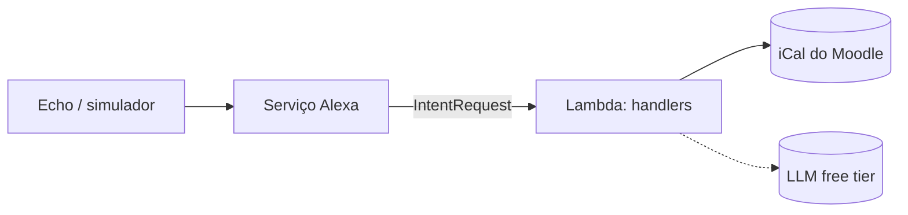

# Alexa AI Assistant

[](https://github.com/gera2727/alexa-ai-assistant/actions/workflows/ci.yml)


[English](README.md) · **Português**

Assistente de voz pessoal para a Amazon Alexa, escrito em Python. Lê os prazos da
faculdade a partir do Moodle e, na próxima fase, responde a perguntas abertas com um LLM.
Funciona inteiramente com planos gratuitos.

> **Utilizador:** "Alexa, pergunta à agenda do isep o que tenho esta semana."
>
> **Alexa:** "Nos próximos 7 dias tens 2 eventos: Entrega Sprint 1, de LAPR3, amanhã às 23:59; e Teste de ESINF, de ESINF, sexta-feira às 10:00."

## Funcionalidades

| Funcionalidade | Exemplo de frase | Estado |
|---|---|---|
| Prazos dos próximos 7 dias | "o que tenho esta semana" | ✅ |
| Eventos num dia ou semana | "o que tenho amanhã", "para a semana" | ✅ |
| Próximo prazo | "qual é a próxima entrega" | ✅ |
| Perguntas abertas com um LLM | "explica-me recursividade" | 🔜 [Sprint 2](https://github.com/gera2727/alexa-ai-assistant/milestone/2) |
| Filtrar por disciplina | "o que tenho de ESINF" | 📋 Backlog |

## Arquitetura



Os handlers são finos e recebem as dependências por injeção. As integrações nunca
importam o SDK da Alexa, por isso são testadas isoladamente. Detalhes em
[docs/architecture.md](docs/architecture.md) (em inglês).

## Estrutura do projeto

```
.
├── lambda/                      # Código publicado na AWS Lambda (estrutura exigida pelas skills Alexa-hosted)
│   ├── lambda_function.py       # Ponto de entrada
│   ├── requirements.txt         # Dependências de runtime
│   ├── config.example.json      # Modelo para o config.json (ignorado pelo Git)
│   └── assistant/
│       ├── skill.py             # Composition root: liga handlers e dependências
│       ├── config.py            # Configuração a partir de variáveis de ambiente ou config.json
│       ├── dates.py             # Interpretação do slot AMAZON.DATE
│       ├── speech.py            # Construção das frases em português europeu
│       ├── handlers/            # Um módulo por área (builtin, calendar, errors)
│       └── integrations/        # Serviços externos (moodle; llm a seguir)
├── skill-package/               # Manifesto da skill e modelo de interação
├── tests/
│   ├── unit/                    # Funções puras, sem SDK
│   ├── integration/             # Pedido Alexa completo → resposta falada
│   └── fixtures/                # .ics de exemplo
└── docs/
    ├── architecture.md
    ├── setup.md
    └── adr/                     # Registos de decisões de arquitetura
```

## Como começar

```bash
git clone https://github.com/gera2727/alexa-ai-assistant.git
cd alexa-ai-assistant
python3 -m venv .venv && source .venv/bin/activate
pip install -r requirements-dev.txt
pytest
```

Para publicar numa skill Alexa real, segue o [docs/setup.md](docs/setup.md).

## Práticas de engenharia

- **Testes:** testes unitários para a lógica pura, mais testes end-to-end que enviam
  pedidos Alexa reais pela skill, com um calendário falso e um relógio fixo.
- **CI:** o GitHub Actions corre o `ruff` (lint e formatação) e o `pytest` em Python 3.10 e 3.12.
- **Decisões** registadas como [ADRs](docs/adr/README.md): alojamento, idioma e escolha do LLM.
- **Processo:** Scrum individual, com sprints semanais, gerido no [board do GitHub Projects](https://github.com/gera2727/alexa-ai-assistant/projects).
- **Segurança:** o URL do Moodle contém um token pessoal. É lido do ambiente ou de um
  ficheiro ignorado pelo Git, e nunca é registado nos logs.

## Roadmap

Ver o [board do projeto](https://github.com/gera2727/alexa-ai-assistant/projects) e o [CHANGELOG.md](CHANGELOG.md).

## Licença

[MIT](LICENSE)
