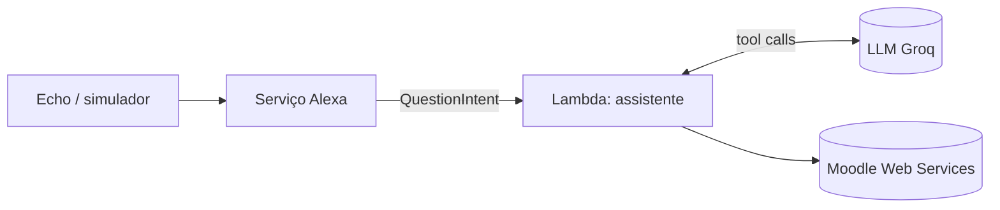

# Alexa AI Assistant

[](https://github.com/gera2727/alexa-ai-assistant/actions/workflows/ci.yml)


[English](README.md) · **Português**

Assistente de voz pessoal para a Amazon Alexa, escrito em Python. Pergunta o que quiseres
sobre o Moodle da tua faculdade, por palavras tuas: um LLM decide que dados ir buscar
(calendário, disciplinas, materiais, trabalhos) através de tool calling e responde numa
frase curta. Funciona inteiramente com planos gratuitos.

> **Utilizador:** "Alexa, pergunta à agenda do isep quando é o teste de ESINF."
>
> **Alexa:** "O teste de ESINF é na sexta-feira, dia 6, às 10:00."

## Funcionalidades

| Funcionalidade | Exemplo de frase | Estado |
|---|---|---|
| Calendário: testes, exames, prazos | "o que tenho amanhã", "quando é o teste de ESINF" | ✅ |
| Prazos de trabalhos, por disciplina | "que entregas tenho de LAPR3" | ✅ |
| Materiais das disciplinas | "que materiais há em ARQCP" | ✅ |
| Disciplinas inscritas | "quais são as minhas disciplinas" | ✅ |
| Horário e salas | "onde é que tenho aula hoje" | 📋 Backlog |

## Arquitetura



Um único intent "apanha-tudo" envia a pergunta inteira para um ciclo de agente. O LLM
chama ferramentas só de leitura, as ferramentas chamam o Moodle, e cada camada recebe as
dependências por injeção, por isso todas são testadas sem rede. A decisão está explicada
no [ADR 0004](docs/adr/0004-free-form-questions.md) (em inglês). Detalhes em
[docs/architecture.md](docs/architecture.md) (em inglês).

## Estrutura do projeto

```
.
├── lambda/                      # Código publicado na AWS Lambda (estrutura exigida pelas skills Alexa-hosted)
│   ├── lambda_function.py       # Ponto de entrada
│   ├── requirements.txt         # Dependências de runtime
│   ├── config.example.json      # Modelo para o config.json (ignorado pelo Git)
│   └── assistant/
│       ├── skill.py             # Composition root: liga handlers e dependências
│       ├── config.py            # Configuração a partir de variáveis de ambiente ou config.json
│       ├── agent.py             # Ciclo de tool calling do LLM e prompt de sistema
│       ├── tools.py             # Ferramentas (só de leitura) que o LLM pode chamar
│       ├── handlers/            # Handlers da Alexa (question, builtin, errors)
│       └── integrations/        # moodle_api, llm (sem imports da Alexa)
├── scripts/                     # Ajudas de configuração: obter o token do Moodle, testar a API
├── skill-package/               # Manifesto da skill e modelo de interação
├── tests/
│   ├── unit/                    # Funções puras, sem SDK
│   └── integration/             # Pedido Alexa completo → resposta falada
└── docs/
    ├── architecture.md
    ├── setup.md
    └── adr/                     # Registos de decisões de arquitetura
```

## Como começar

```bash
git clone https://github.com/gera2727/alexa-ai-assistant.git
cd alexa-ai-assistant
python3 -m venv .venv && source .venv/bin/activate
pip install -r requirements-dev.txt
pytest
```

Para publicar numa skill Alexa real, segue o [docs/setup.md](docs/setup.md).

## Práticas de engenharia

- **Testes:** cada integração é testada com um transporte falso (sem rede), o ciclo do agente
  com um LLM "guionado", e os testes end-to-end enviam pedidos Alexa reais pela skill.
- **CI:** o GitHub Actions corre o `ruff` (lint e formatação) e o `pytest` em Python 3.10 e 3.12.
- **Decisões** registadas como [ADRs](docs/adr/README.md): alojamento, idioma, fornecedor do LLM e o design das perguntas livres.
- **Processo:** Scrum individual, com sprints semanais, gerido no [board do GitHub Projects](https://github.com/gera2727/alexa-ai-assistant/projects).
- **Segurança:** o token do Moodle e a chave do Groq são lidos do ambiente
  ou de um ficheiro ignorado pelo Git, enviados no corpo dos pedidos (nunca no URL) e nunca
  registados nos logs. As ferramentas são só de leitura.

## Roadmap

Ver o [board do projeto](https://github.com/gera2727/alexa-ai-assistant/projects) e o [CHANGELOG.md](CHANGELOG.md).

## Licença

[MIT](LICENSE)
