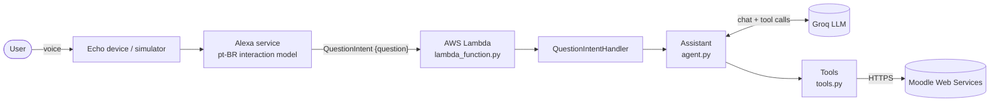

# Architecture

## Overview



1. The Alexa service captures the whole sentence in the `question` slot of `QuestionIntent`
   (a catch-all custom slot, see [ADR 0004](adr/0004-free-form-questions.md)).
2. `QuestionIntentHandler` passes the question to the `Assistant`.
3. The `Assistant` sends the question to the LLM with the list of available tools. The LLM asks for
   the data it needs (for example `get_calendar_events` for "o que tenho amanhã"), the tools fetch it
   from Moodle, and the results go back to the LLM, at most `MAX_TOOL_ROUNDS` times.
4. The LLM's final short answer, in European Portuguese, is what Alexa says.

## Layers

| Layer | Path | Depends on | Rule |
|---|---|---|---|
| Entry point | `lambda/lambda_function.py` | `skill` | One line. The name is fixed by Alexa-hosted skills. |
| Composition root | `lambda/assistant/skill.py` | everything | The only place where concrete dependencies are chosen. |
| Handlers | `lambda/assistant/handlers/` | Alexa SDK | Thin: read the slot, call the assistant, respond. |
| Agent | `lambda/assistant/agent.py` | a `ChatModel`, `ToolBox` | The tool-calling loop and the system prompt. No HTTP. |
| Tools | `lambda/assistant/tools.py` | integrations | Read-only functions + JSON schemas the LLM can call. |
| Integrations | `lambda/assistant/integrations/` | stdlib only | **Must not import the Alexa SDK.** One module per external service. |

| Integration | Talks to |
|---|---|
| `moodle_api.py` | Moodle Web Services REST: calendar events, courses, materials, assignments |
| `llm.py` | Groq's OpenAI-compatible chat completions API |

## Dependency injection

Every class receives its collaborators through the constructor, so tests replace the network with fakes:

```python
Assistant(llm=GroqClient(key), tools=build_toolbox(calendar, moodle, clock), clock=lisbon_now)
MoodleApi(url, token, transport=fake_transport)  # tests: canned JSON, no HTTP
build_skill(assistant=FakeAssistant())  # tests: full Alexa envelope, no LLM
```

`skill.py` builds the real `Assistant` lazily on the first question, so a missing setting is spoken
as an error instead of crashing the Lambda at cold start.

## Constraints that shaped the design

- **~8 second response limit.** Short timeouts (Groq 4 s, Moodle 3 s), at most 3 tool rounds,
  and the course list is cached in a warm Lambda container.
- **No secrets in Git.** The Moodle token and Groq key live in a git-ignored `config.json`
  or in environment variables. Tokens are sent in request bodies, never in URLs or logs. See [`config.py`](../lambda/assistant/config.py).
- **Prompt injection.** Tools are read-only, and the system prompt treats tool output as data.
- **Zero cost.** See [ADR 0001](adr/0001-alexa-hosted.md) and [ADR 0003](adr/0003-free-tier-llm.md).
- **No pt-PT locale.** See [ADR 0002](adr/0002-pt-br-locale.md).

## Adding a data source

1. Create `lambda/assistant/integrations/<name>.py`, free of Alexa imports, with unit tests.
2. Add a `Tool` (name, description, JSON schema, function) in `build_toolbox` in `tools.py`.
3. Test it in `tests/unit/test_tools.py`. No intent or interaction model change is needed.
