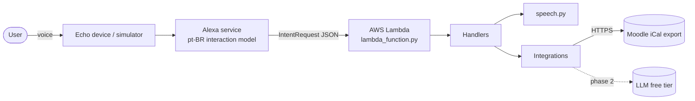

# Architecture

## Overview



1. The Alexa service turns speech into an **intent** plus **slots**, using the
   interaction model in `skill-package/interactionModels/custom/pt-BR.json`.
2. Lambda receives the request. `assistant/skill.py` routes it to the first
   handler whose `can_handle` returns `True`.
3. The handler asks an **integration** for data, then uses `speech.py` to
   build the sentence Alexa will say.

## Layers

| Layer | Path | Depends on | Rule |
|---|---|---|---|
| Entry point | `lambda/lambda_function.py` | `skill` | One line. The name is fixed by Alexa-hosted skills. |
| Composition root | `lambda/assistant/skill.py` | everything | The only place where concrete dependencies are chosen. |
| Handlers | `lambda/assistant/handlers/` | Alexa SDK, speech, integrations | Thin: parse the request, call a service, respond. |
| Speech | `lambda/assistant/speech.py` | domain types | Pure functions. All user-facing Portuguese text lives here or in handler constants. |
| Dates | `lambda/assistant/dates.py` | — | Parses `AMAZON.DATE` slot values. Pure. |
| Integrations | `lambda/assistant/integrations/` | stdlib, third-party clients | **Must not import the Alexa SDK**, so they can be reused and tested alone. |

## Dependency injection

Handlers receive their dependencies through the constructor:

```python
UpcomingEventsIntentHandler(events=MoodleCalendar(url), clock=lisbon_now)
```

`events` is any callable that returns `list[Event]`, and `clock` any callable that
returns the current `datetime`. Tests pass fakes (`lambda: sample_events`), so the
full request → response path is tested with no network and a fixed "now".

## Constraints that shaped the design

- **~8 second response limit.** Alexa drops slow responses. The iCal download has a
  4 s timeout, and the LLM provider is chosen for latency (see [ADR 0003](adr/0003-free-tier-llm.md)).
- **No secrets in Git.** The Moodle URL contains a personal token. See [`config.py`](../lambda/assistant/config.py).
- **Zero cost.** See [ADR 0001](adr/0001-alexa-hosted.md).
- **No pt-PT locale.** See [ADR 0002](adr/0002-pt-br-locale.md).

## Adding an integration

1. Create `lambda/assistant/integrations/<name>.py`. Keep it free of Alexa imports.
2. Add unit tests in `tests/unit/test_<name>.py`.
3. Add an intent and sample utterances to the interaction model.
4. Add a handler in `lambda/assistant/handlers/` and register it in `skill.py`.
5. Add an end-to-end test in `tests/integration/`.
